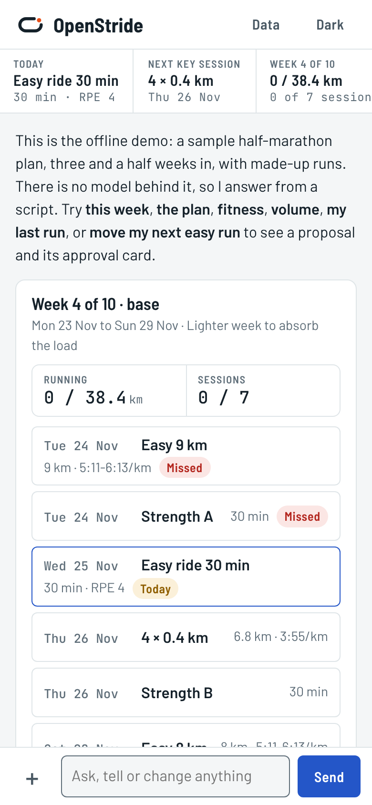
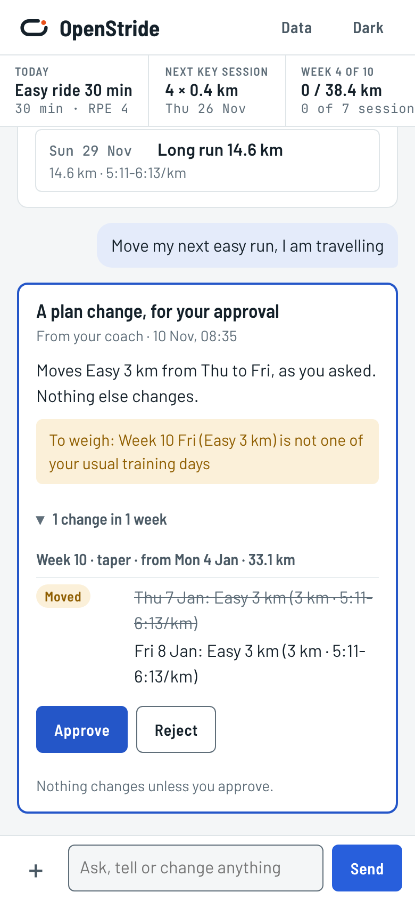
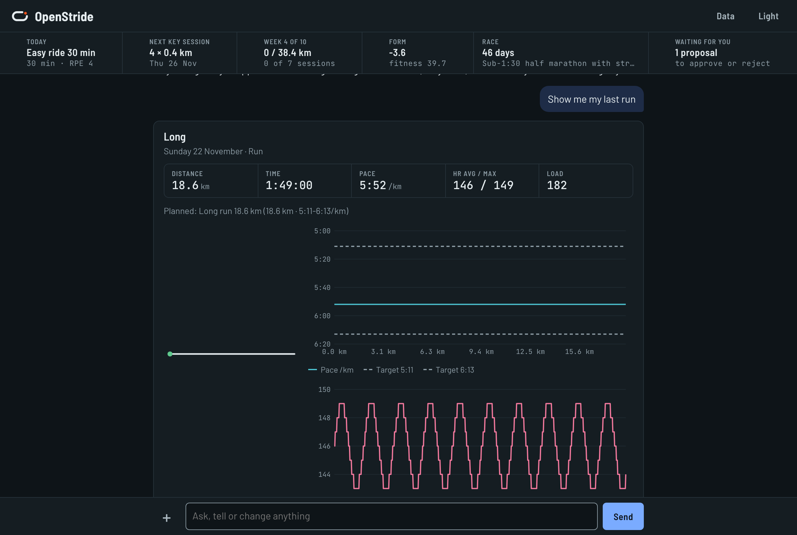

# OpenStride

**An open-source running coach where the agent is the interface.** You talk to one coach, on your phone or your laptop, and it does what you ask: sets up your plan, reads your runs, explains a chart, moves a session, logs a sore calf. There are no pages or menus underneath, only your training data as files on your own machine and an agent that works in them.

One thing waits for you: **a change to your training plan.** Everything else the agent does on its own authority. MIT licensed.

<p>


</p>

---

## The idea

Hardcoding coaching logic isn't worth it. Models keep getting better; a rulebook written today doesn't. Earlier versions of OpenStride gave the model three tools and a fixed prompt, so a better model could only write better prose inside the same box.

This version turns that inside out. The app is a **workspace** the agent works in:

| | |
|---|---|
| **Data is files** | Your plan, your activities, wellness, the coach's notes, a journal: a folder (`data/workspace/`) the agent reads with whatever it finds best, and a git repository, so every change has a reason and an undo |
| **Every action is a command** | `openstride` does what code must do exactly: paces, dates, validating a plan, showing a card, reaching the provider. The agent types it; so can you |
| **One gate** | `plan/` is written only when you approve a proposal. Enforced in code, not in a prompt |
| **The record is not the agent's** | What your watch recorded and the provider computed is written only by the sync. A disagreement goes in a note beside it |
| **Analysis is a provider's job** | intervals.icu analyses your files, keeps fitness and wellness, and sends workouts to your watch. OpenStride defines the contract; another analyzer can plug in behind it |
| **An analyst behind the coach** | Questions that need computation go to a second agent that runs code over a read-only copy of your data and returns a report, charts and, when it concerns the plan, a proposal |

A stronger model reads more of the data, writes better throwaway analysis and follows the skills more carefully, with no code change. That is the point.

The full reasoning is in [docs/design/agent-first.md](docs/design/agent-first.md).

---

## What it is like to use

**One screen.** A header with today's session, your next key session, the week, your form and the days to the race. A conversation below it. One box to type in, which also takes a photo or a `.fit` file.

**The coach shows, not tells.** Ask how the week is going and you get the week as a card, drawn by code the same way every time, and two sentences on what to notice. Cards: a week, a session, an activity with pace and heart rate against the plan, fitness and fatigue, weekly volume, the plan, a table, a chart, an analyst's report.

**A plan change is a card with two buttons.** "Move Thursday to Saturday", a new plan, a skipped session, a rebuild after illness: the coach drafts it, the validator checks it, and you see what moves, what it costs and why. Facts are refused (a session moved into the past, something already done altered, two runs on one day). Judgments are shown to you and never block (not one of your usual days, hard days back to back, a jump in volume). Nothing changes unless you approve; when you do, the new sessions go to your watch through the provider's calendar.

**The coach checks in.** A review when a run arrives, a look back when a week ends, a report after the race. Optional: a morning brief, a wellness signal, a four-week block review. Quiet hours and a monthly budget are settings you change by asking.

**It remembers.** `athlete/memory.md` holds what data can't say: who you are, your history, how you respond to training, what you agreed. It outlives plans and conversations, and you can read and edit it.

**You can look underneath.** The Data drawer lists every file with who may write it, its history, and what the agents have cost this month.

<p>

</p>

---

## How it is built

```
  phone / laptop        one stream, cards, an approval card, one input
        │
  OpenStride server     the gate, the write boundary, the turn queue, the cards, the triggers, the provider sync
        │
  the coach             Claude Agent SDK harness: a shell and file tools in the workspace, skills, the openstride CLI
        │      └──── the analyst: a second agent in its own folder, workspace read-only, computes and reports
  data/workspace/       plan/  proposals/  activities/  wellness/  athlete/  notes/  journal/  reports/   (a git repository)
        ▲
  provider              intervals.icu today; a contract any analyzer can implement  ←→  Garmin, Coros, Polar, Suunto, Wahoo
```

**Who may write what** is fixed in code, in three tiers:

| Tier | Paths | Who writes |
|---|---|---|
| Recorded | `activities/`, `wellness/`, `athlete/profile.yaml` | Only the provider sync |
| Gated | `plan/` | Only your approval of a proposal |
| Authored | notes, journal, reviews, settings, the coach's memory | The agent, freely; git keeps every version |

**How the boundary holds.** Before each tool call a check refuses writes to protected paths, git commands that change history, anything that reaches the network or the server's secrets. On a machine that can (macOS; Linux with bubblewrap and socat) the agents' shells also run in an OS sandbox: the protected folders are read-only, there is no network, the server's state is unreadable. After every turn, anything that still differs from the last server commit in a protected path is put back and the agent is told. The Approve button is the only caller of `plan apply`, and it is not reachable from an agent's shell. Without the OS sandbox the first and third layers still hold for files, but the shell itself is not confined; `openstride doctor` says which you have.

**The provider contract** is in `app/providers/base.py`: activities with their analysis, recordings, wellness and athlete settings are required; a calendar, uploads, wellness notes, hand-logged sessions and gear are capabilities a provider declares. The mirror keeps a neutral shape with the provider's own record under `source`. There are two implementations, intervals.icu and a fixture provider, and both pass the same conformance test.

---

## How I know it works

- **217 automated tests** (`uv run pytest`): the validator (each rule triggered by a mutated plan), the gate (every way to apply without approval), the write boundary and the tool-call check, both providers against the contract (intervals.icu through a fake HTTP transport), the mirror and calendar, the cards, the turn loop driven by a scripted agent, the agent API, the CLI, the triggers, the migration and the server.
- **Live runs of the real harness** against the demo workspace, with and without the OS sandbox: a question answered with a card, a plan change drafted as a proposal, a session logged at the provider, the guard rails probed (plan and record read-only, network closed, state unreadable), and an analyst run that computed with a script and filed its report. Those runs found seven bugs that are fixed and now covered by tests.
- **An offline demo** with no API key: `OPENSTRIDE_DEMO=1 uv run openstride`.

**Not yet verified:** the intervals.icu connector has not been run against the live API. It is written from a maintained client's request and response shapes and tested against a fake. `openstride doctor` checks your connection, and `openstride doctor --write` proves the calendar by creating and removing one test workout a year out. The Docker image builds on the same code but has not been run.

---

## Run it

You need [uv](https://docs.astral.sh/uv/), git, a [Claude API key](https://platform.claude.com/) and an [intervals.icu](https://intervals.icu) account with your watch connected to it.

```bash
git clone https://github.com/danielfodgaard/OpenStride.git
cd OpenStride
uv sync --extra analyst
cp .env.example .env        # ANTHROPIC_API_KEY, INTERVALS_ICU_API_KEY, INTERVALS_ICU_ATHLETE_ID
uv run openstride doctor    # checks the provider, the key, the harness and the sandbox
uv run openstride
```

Open http://127.0.0.1:8000 and tell your coach about your next race.

**Coming from 0.1:** the first start brings your plan with its versions, the coach's notes, and your reviews and chat into the workspace by itself. Nothing in the old `data/` files is changed or removed. See [docs/SETUP.md](docs/SETUP.md#coming-from-01).

**Phone access, the sandbox, Docker, password and backups:** [docs/SETUP.md](docs/SETUP.md).

---

## What it costs

OpenStride is free. You pay for your own Claude API usage, and intervals.icu is free for your own data. Every turn's cost is recorded as the harness reports it; the Data drawer shows the month's total, and `budget.monthly_usd` in settings pauses the agent's own check-ins when it is reached.

There are no measured per-action figures for this version yet. A turn now reads only what the question needs instead of the whole plan and history, and uses more round trips to do it, so the old numbers do not carry over. Models are settings: Claude Opus 5.5 for the coach and the analyst by default, a cheaper one for the analyst's bulk reading. You change them by asking.

---

## What's next

- The intervals.icu connector run against a real account, and the workout syntax checked on a real watch.
- Measured costs per kind of turn.
- A second real provider behind the contract.
- The agent and the server in separate containers, so the boundary in Docker does not depend on the sandbox.

---

## Licence

MIT, see [LICENSE](LICENSE). The dependencies are under permissive licences compatible with MIT: FastAPI, Pydantic, the Claude Agent SDK, PyYAML and pytest (MIT), uvicorn, httpx and python-dotenv (BSD-3-Clause), python-multipart (Apache-2.0). The optional analyst extra adds pandas, numpy and scipy (BSD-3-Clause) and matplotlib (PSF-based).
